## I am interested in artificial intelligence, control theory, signal processing and robotics.

My goal is to leverage my multidisciplinary background to build robust, intelligent autonomous systems that can perceive, learn from, and interact with their physical environments.

## GitHub Statistics

## Languages

  
  
  
  

## Tools

  
  
  

